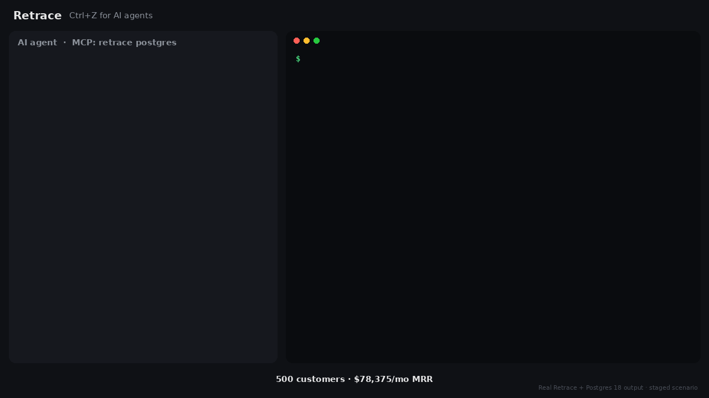
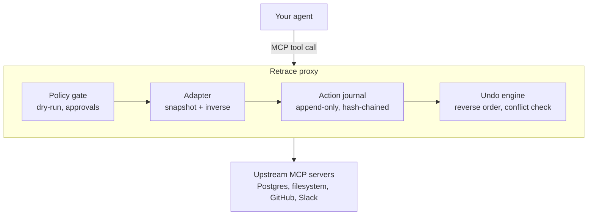

# Retrace

**Ctrl+Z for AI agents. Undo any tool call your agent regrets.**

[](LICENSE)
[](https://www.npmjs.com/package/retrace) <!-- TODO: confirm npm name is available; fallback: @retrace/cli -->
[](https://github.com/kandimallasivaji/retrace/actions)
[](https://modelcontextprotocol.io)

<!-- TODO: replace with demo GIF (see DEMO_SCRIPT.md). Keep it under 5 MB and 20 seconds. -->


```bash
npx retrace wrap -- npx @modelcontextprotocol/server-filesystem ./project
```

Your agent works exactly as before. Every tool call is logged with its before-state, so when something goes wrong:

```bash
retrace log            # see what the agent did
retrace undo --run     # roll back the whole run, newest step first
```

## Why this exists

- **Agents act on real systems now.** They write files, run SQL, open PRs, post to Slack. One bad step can wipe data you can't get back.
- **Checkpoints only cover the chat or the code.** Most agent tools can rewind the conversation or your working directory. Nothing rewinds the side effects in your database, GitHub, or Slack.
- **Retrace works with the agent you already use.** It's an MCP proxy, so there's no framework to adopt and no code to change.

## Works with

| Agent / client | Status |
|---|---|
| Claude Desktop | ✅ |
| Claude Code | ✅ |
| Cursor | ✅ |
| Any MCP client (TypeScript / Python SDK) | ✅ |

| Upstream tool | Undo type | Status |
|---|---|---|
| Filesystem | Reversible (exact restore) | ✅ |
| Postgres | Reversible (single-table DML) | ✅ |
| GitHub | Compensable (close, revert, recreate branch) | 🚧 |
| Slack | Compensable (delete message) | 🚧 |
| Stripe, Notion, Google Workspace | | Planned |

<!-- TODO: update statuses to match what actually ships at launch. -->

## Features

- **Undo a step or a whole run** with `retrace undo <step>` or `retrace undo --run <id>`.
- **Dry-run any agent** with `--dry-run` to see what it *would* change without touching anything.
- **Pause irreversible actions** like sending an email until you approve them.
- **Catch conflicts** before undoing. If someone changed the data after the agent, Retrace warns and skips instead of overwriting their work.
- **Keep a tamper-evident audit log.** Every action is hash-chained in a local SQLite journal.
- **Write your own adapter** in about 50 lines. <!-- TODO: verify once adapter API is final -->

## How it works



Every action falls into one of three classes:

| Class | Meaning | Example |
|---|---|---|
| **Reversible** | Retrace restores the exact before-state | File write, row update |
| **Compensable** | Retrace runs a reverse action | Close a created issue, delete a Slack message |
| **Irreversible** | Can't be taken back, so it's held for approval | Sending an email |

## Use with Claude Desktop

In `claude_desktop_config.json`, wrap any existing server:

```json
{
  "mcpServers": {
    "filesystem": {
      "command": "npx",
      "args": ["retrace", "wrap", "--",
               "npx", "@modelcontextprotocol/server-filesystem", "/Users/you/project"]
    }
  }
}
```

## Safety and limits

Retrace is honest about what it can't do:

- **It can't unsend things.** A Slack message can be deleted, but someone may have already read it. Truly irreversible actions are held for approval instead.
- **Postgres support is narrow at first.** Single-table `INSERT`, `UPDATE`, and `DELETE`. DDL, triggers, and cascades aren't reversed yet.
- **Calls that skip the proxy aren't tracked.** If the agent reaches a system some other way, Retrace never sees it.
- **Your data stays local.** The journal lives in `~/.retrace/journal.db` and includes before-state snapshots, so treat it like the data it protects.

Overhead per tool call: <!-- TODO: measure and state method, e.g. "~X ms p50 on filesystem writes, M2 MacBook" -->

## Why not just…

| Alternative | Where it wins | Where Retrace helps |
|---|---|---|
| Git / file checkpoints | Great for code | Doesn't cover databases or SaaS |
| Database backups | Full recovery | Restores everything, not one agent's changes |
| Human approval on every call | Maximum control | Slows agents down; Retrace only pauses irreversible steps |

## Roadmap

- [ ] GitHub and Slack adapters to stable
- [ ] Web UI for browsing runs
- [ ] Python SDK for in-process use
- [ ] Stripe, Notion, Google Workspace adapters

See [open issues](https://github.com/kandimallasivaji/retrace/issues).

## Contributing

Adapters are the easiest way in. Each one is a small file with two functions: capture before-state and build the inverse. Start with [CONTRIBUTING.md](CONTRIBUTING.md) and the `good first issue` label.

If Retrace saved you from a bad agent run, a star helps others find it.

## License

MIT
