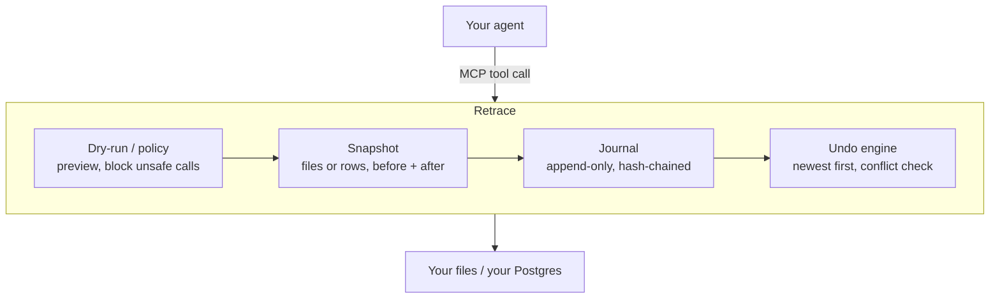

# Retrace

**Ctrl+Z for AI agents. Undo any file or database change your agent makes.**

[](https://github.com/kandimallasivaji9/retrace/actions/workflows/ci.yml)
[](https://www.npmjs.com/package/retrace-agent)
[](LICENSE)
[](https://modelcontextprotocol.io)


*The agent asked first. The human clicked the wrong option. One command fixed it.*

## Try it in 30 seconds

```bash
npm install -g retrace-agent

# Put Retrace in front of any MCP server
retrace wrap -- npx -y @modelcontextprotocol/server-filesystem ./project
```

Your agent works exactly as before. Every change is recorded with its before-state, so when something goes wrong:

```bash
retrace log            # see what the agent did
retrace undo --run     # roll back the whole run, newest step first
```

Prefer not to install? Use `npx -y retrace-agent wrap -- ...` instead.

## Why this exists

- **Agents act on real systems now.** They edit files and run SQL. One bad step, or one wrong click on "approve", can wipe data you need.
- **Asking first isn't enough.** Good agents confirm before destructive actions. People still approve the wrong thing.
- **Checkpoints don't cover side effects.** Agent tools can rewind the chat or your code. Nothing rewinds the rows your agent deleted.
- **No framework to adopt.** Retrace is an MCP server, so it works with the agent you already use.

## What it can undo today

| Target | How | Status |
|---|---|---|
| Files (wraps `@modelcontextprotocol/server-filesystem`) | Exact restore of writes, edits, moves, new folders | ✅ |
| Postgres 18+ (`retrace postgres`) | Row-level undo of `INSERT`, `UPDATE`, `DELETE` | ✅ |
| GitHub, Slack, Stripe | Compensating actions (close, delete, refund) | Planned |

| Client | Status |
|---|---|
| Claude Desktop | ✅ Tested |
| Claude Code, Cursor, other stdio MCP clients | Should work (standard MCP over stdio). Reports welcome. |

## Features

- **Undo a step or a whole run** with `retrace undo <id>` or `retrace undo --run`.
- **Dry-run any agent** with `--dry-run`: real diffs and exact row counts, nothing changed.
- **Catch conflicts.** If a person changed the data after the agent, undo stops instead of overwriting their work.
- **Block what can't be undone.** `DROP`, `ALTER`, `TRUNCATE`, multi-statement SQL, and writes to tables without a primary key are refused.
- **Keep a tamper-evident audit log.** Every action is hash-chained in a local SQLite journal; `retrace verify` checks it.

## Postgres

Retrace ships its own Postgres MCP server. Reads work normally, and every write is recorded row by row so it can be undone exactly.

```bash
retrace postgres --url postgres://localhost/mydb
```

No database handy? Clone the repo and run `npm run demo-db` for a throwaway Postgres 18 with 500 sample customers (it's the database in the GIF).

```bash
retrace log
#  #1  execute  applied  DELETE 412 rows in public.customers
retrace undo --run
#  ✓ #1 execute undone
```

The journal never stores passwords. If your database needs one, set `RETRACE_PG_URL` (or pass `--url`) when you run `retrace undo`.

## Dry run

Not sure what an agent will do? Let it plan first:

```bash
retrace wrap --dry-run -- npx -y @modelcontextprotocol/server-filesystem ./project
retrace postgres --dry-run --url postgres://localhost/mydb
```

The agent gets a preview instead of a real change: a diff for every file write, or "Would DELETE 412 rows" with sample rows for SQL. Nothing is changed. `retrace log` shows the whole plan.

## Use with Claude Desktop

In Claude Desktop, open **Settings → Developer → Edit Config** and add:

```json
{
  "mcpServers": {
    "files": {
      "command": "npx",
      "args": ["-y", "retrace-agent", "wrap", "--",
               "npx", "-y", "@modelcontextprotocol/server-filesystem", "/Users/you/project"]
    },
    "db": {
      "command": "npx",
      "args": ["-y", "retrace-agent", "postgres", "--url", "postgres://localhost/mydb"]
    }
  }
}
```

If Claude Desktop can't find `npx`, use its full path (`which npx`).

## How it works



- **Files:** before each change, Retrace snapshots the paths the tool call touches. Undo restores those exact bytes.
- **Postgres:** every write runs with `RETURNING old.*, new.*` (new in Postgres 18), so Retrace records each affected row as it was and as it became, inside the same transaction. Undo rebuilds rows with their real column types and puts them back in one transaction.

## Safety and limits

Retrace is honest about what it can't do:

- **Postgres needs version 18+**, and tables need a primary key.
- **Cascades and triggers aren't reversed yet.** If a delete cascades to other tables, only the rows the agent deleted come back. `WITH` and `MERGE` statements are blocked for now.
- **Dry runs don't simulate state.** If the agent "writes" a file during a dry run and then reads it, it sees the original.
- **Only calls that go through Retrace are tracked.**
- **Files over 10 MB aren't snapshotted**, and `create_directory` only removes the last folder it created.
- **Your data stays local.** The journal at `~/.retrace/journal.db` holds before-state snapshots, so treat it like the data it protects.

Overhead: about 1.3 ms per file write at the median (2.3 ms vs 1.1 ms direct, 2 KB writes, 300 calls, Linux).

## Why not just…

| Alternative | Where it wins | Where Retrace helps |
|---|---|---|
| Git / file checkpoints | Great for code | Doesn't cover databases |
| Database backups / PITR | Full recovery | Rolls back *everything*, not just one agent's changes |
| Approval prompts | Stops many mistakes | People still approve the wrong thing; undo is the backstop |

## Roadmap

- [ ] Approval gate for actions that can't be undone (sending email, payments)
- [ ] GitHub and Slack adapters
- [ ] Pluggable adapter API
- [ ] Web UI for browsing runs

See [open issues](https://github.com/kandimallasivaji9/retrace/issues).

## Contributing

`npm test` runs everything end to end with a real MCP client and a throwaway Postgres; no setup needed. Start with [CONTRIBUTING.md](CONTRIBUTING.md) and the [`good first issue`](https://github.com/kandimallasivaji9/retrace/labels/good%20first%20issue) label.

If Retrace saved you from a bad agent run, a star helps others find it.

## License

[MIT](LICENSE)
